 

**C++ · Reverse Engineering · DDNet · Linux**

Build. Break. Understand. Improve.

---

### About

Developer interested in low-level programming, client engineering, automation, and experimentation.

### Focus

- **C / C++** — systems, performance, tooling
- **DDNet / Teeworlds** — client development, Lua integrations
- **Linux** — development and customization
- **Python** — automation and utilities

  Code is the experiment.

